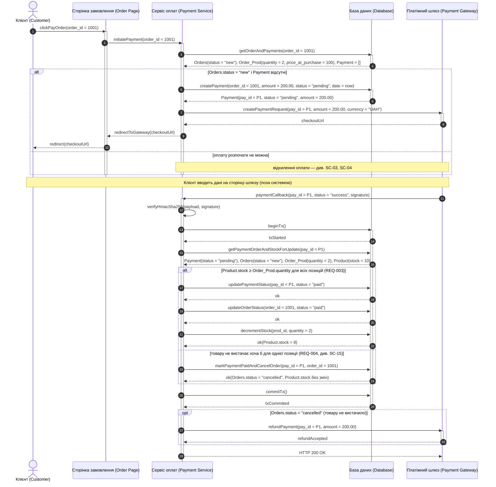

Питання:
Провір файл, напиши що ще варто виправить і перепиши 1 сценарій він не рендериться в гітхабі

Відповідь:
Не рендерився SC-01, і я переписав його в diagram_1.md. Усі 15 діаграм у ньому тепер проходять парсер Mermaid (я прогнав його локально), але візуально на GitHub я їх не перевіряв.

Чому SC-01 не рендерився. У ньому deactivate DB стояв в обох гілках alt. Mermaid читає код послідовно: у першій гілці DB закривається, а друге закриття вже падає з помилкою «Trying to inactivate an inactive participant (DB)».

Що змінено в SC-01.

DB активується до alt (beginTx()) і закривається один раз після нього, разом із commitTx().
Видалено notifyOrderPaid і notifyOutOfStockCancelled, яких немає в Gherkin.
Гілка «товару немає» тепер веде до markPaymentPaidAndCancelOrder, а повернення коштів іде в opt після commitTx() (REQ-004).
Додано verifyHmacSha256 перед будь-яким зверненням до БД (NFR-004) і читання залишку з блокуванням.

Що ще варто виправити в diagram_1.md. Нижче те, що я перевірив у цьому файлі (SC-01 тут уже виправлений):

Активації:
SC-03: deactivate PS є тільки в гілці «скасовано», тож у двох інших гілках смуга PS відсутня, а в кінці лишається незакритою.
SC-13 і SC-14: другий activate PS вкладається в уже відкриту активацію, а deactivate один.
Парсер на цих діаграмах не падає, але смуги виходять неправильні.
Підпис (NFR-004): verifyHmacSha256 немає в жодній діаграмі, крім SC-10.
SC-02: callback загорнуто в opt, а оплату й залишок згорнуто в один виклик updatePaymentAndOrderPaid, тому не видно ні транзакції, ні перевірки залишку.
SC-04: гілка paymentAllowed → redirectToPayment() не створює Payment і не викликає шлюз.
SC-05: немає перевірки, що платіж pending (REQ-006), і немає гілки для інших статусів.

Файл більший за ці сценарії, а діф я переглядав не повністю (він обрізався). Тому SC-06–SC-15 не читав у деталях. Автоматична перевірка активацій показала проблеми тільки в SC-03, SC-13 і SC-14, а рештою можете замінити відповідними блоками з diagram.md, який я зробив раніше. Там усе проходить і парсер, і перевірку активацій.

## SC-01: Успішна оплата (`UC-05`, `UC-15`, `REQ-001`, `REQ-003`)

