Питання:
Виправ SC-07, щоб гілка 409 писала в SecLog і була відокремлена від дубля та від очікуваного переходу. Додай підпис verifyHmacSha256 до всіх діаграм callback та refundCallback де потрібні.
В SC-09 додай транзакцію, блокування і гілку нестачі товару за REQ-004. Прибери подвійний deactivate DB в SC-15. А також поправ невідповідності які сам знайдеш.

Відповідь:

Менші правки

SC-15 тепер питає сторінку через PS/БД, а не показує повідомлення «з повітря».
SecLog повертає просто logged, а «дані не змінено» винесено в Note. Подія скрізь називається logSecurityEvent.
Вгорі додано примітку, що P1/P2/P9999 — умовні позначки pay_id (тип int).
Скрізь HTTP 200 OK іде до refundPayment (NFR-002), а в SC-01 додано примітку про повтор транзакції до 3 разів (NFR-010).
SC-06: перевіряється Payment.date, а markPaymentTimeout спрацьовує лише якщо платіж досі pending.
Планувальник у SC-06 тепер працює напряму з базою даних, як описано в spec.md: він сам знаходить прострочені платежі і сам їх позначає як failed з причиною timeout. Сервіс оплат у циклі більше не бере участі.

# Sequence-діаграми сценаріїв SC-01–SC-15

## SC-01: Успішна оплата (`UC-05`, `UC-15`, `REQ-001`, `REQ-003`)

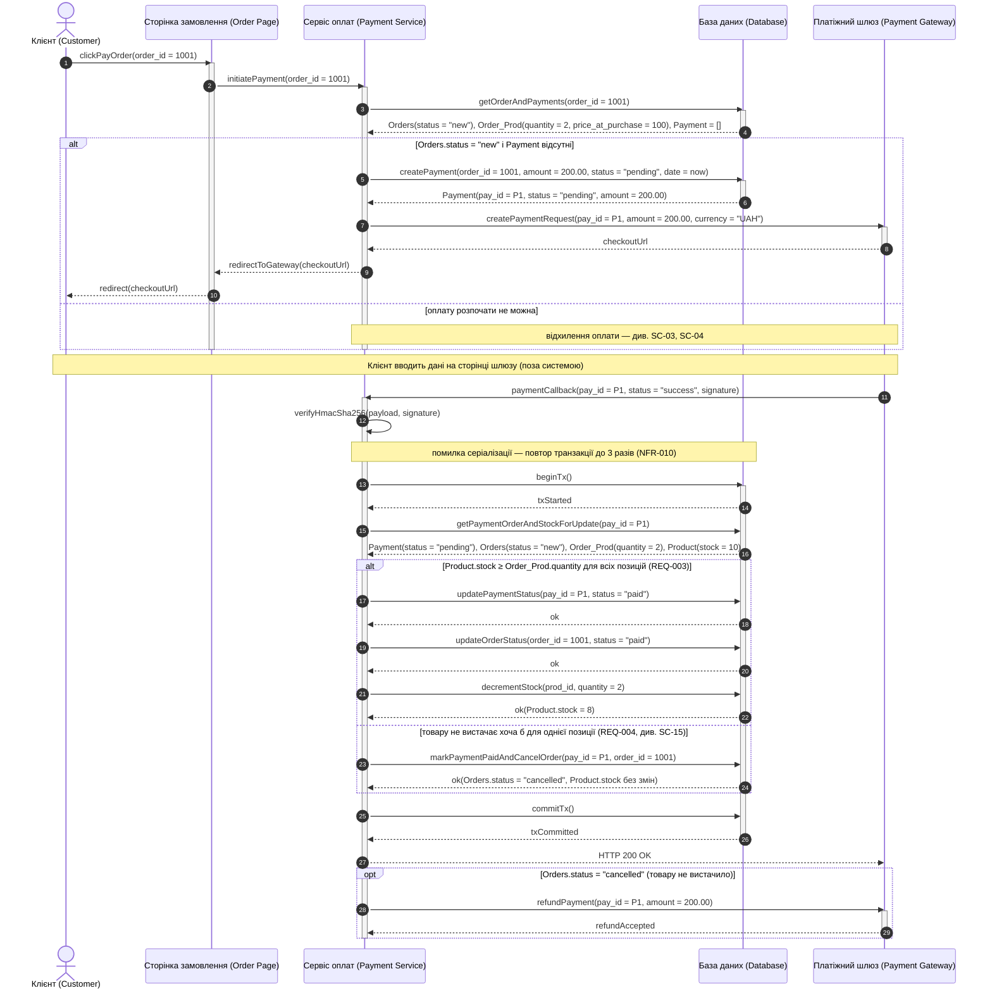

## SC-02: Повторна оплата після невдачі (`UC-05`, `UC-11`, `UC-15`, `REQ-003`, `REQ-008`)

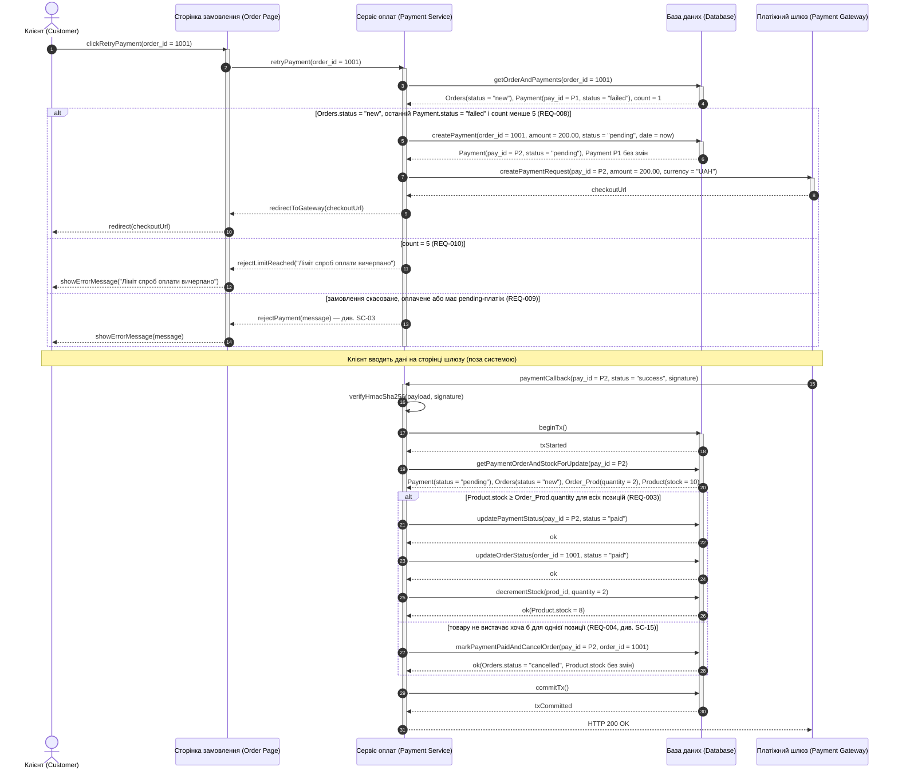

## SC-03: Оплату не можна розпочати (`UC-05`, `REQ-009`)

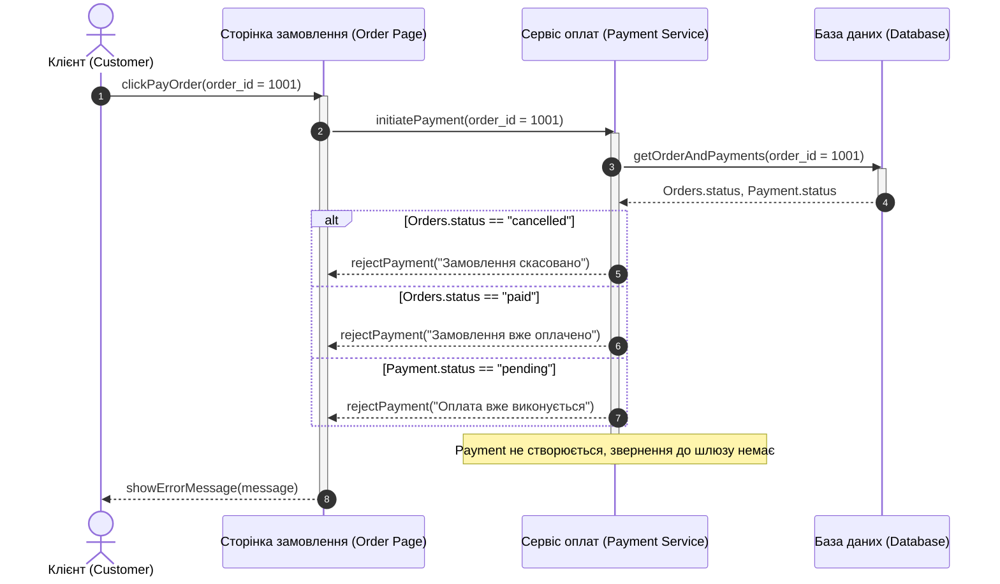

## SC-04: Ліміт спроб оплати вичерпано (`UC-05`, `UC-11`, `REQ-010`, `REQ-015`)

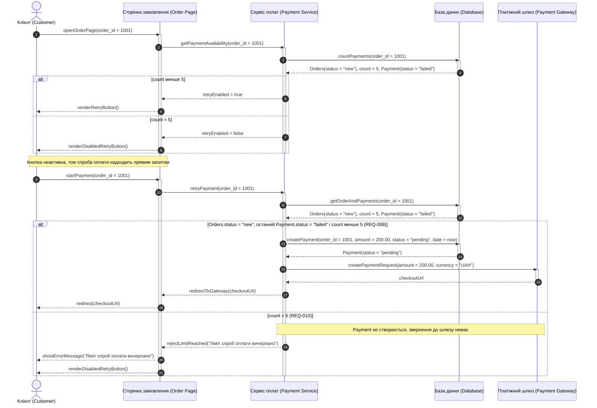

## SC-05: Шлюз відхилив платіж (`UC-15`, `REQ-006`, `REQ-015`)

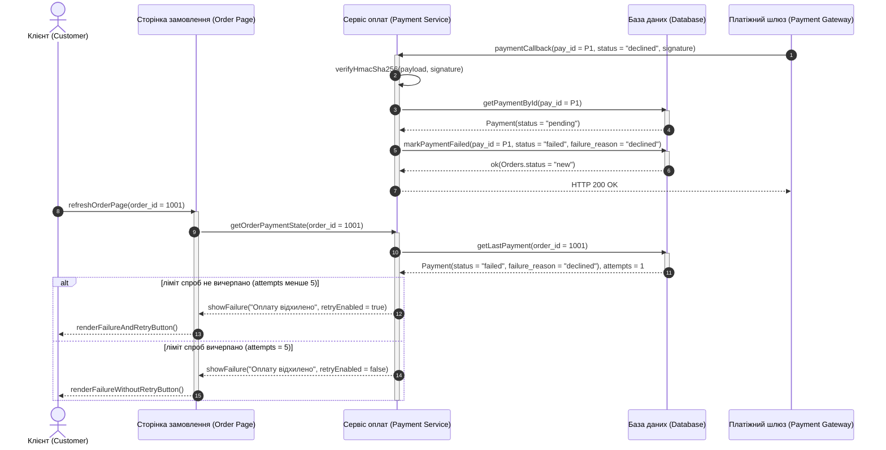

## SC-06: Шлюз не відповів за 15 хвилин (`UC-15`, `REQ-007`, `REQ-015`)

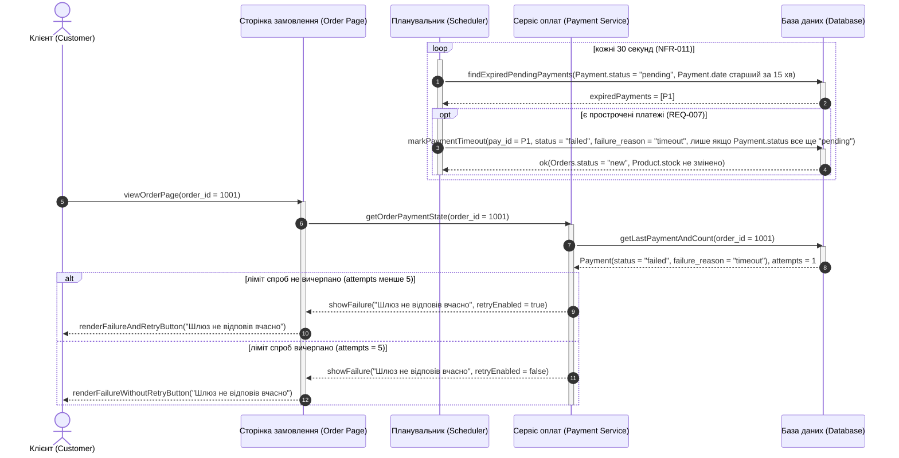

## SC-07: Дубльоване повідомлення шлюзу (`UC-15`, `REQ-011`)

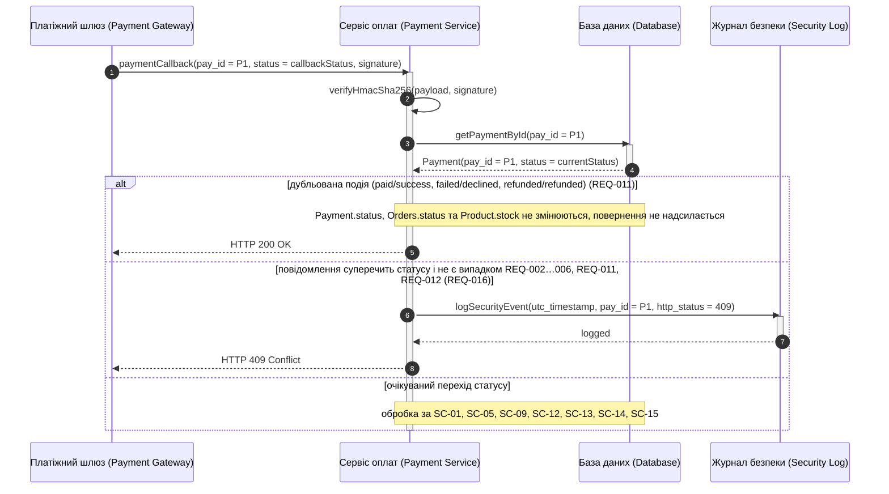

## SC-08: Суперечливе повідомлення шлюзу (`UC-15`, `REQ-016`)

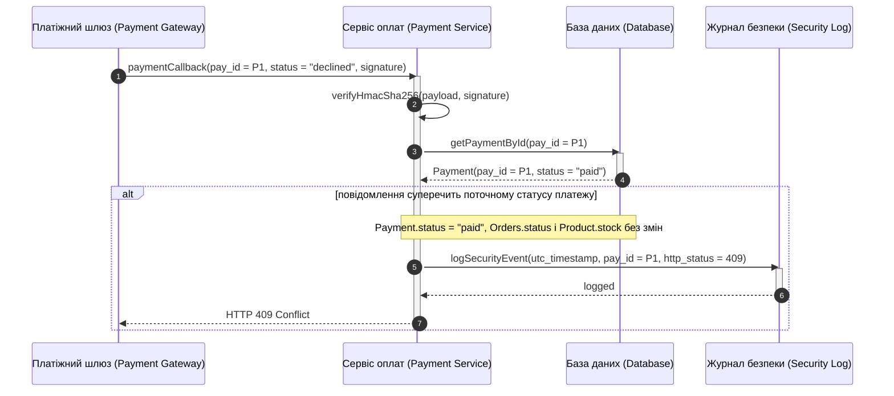

## SC-09: Запізніле success після таймауту, замовлення ще new (`UC-15`, `REQ-003`, `REQ-012`)

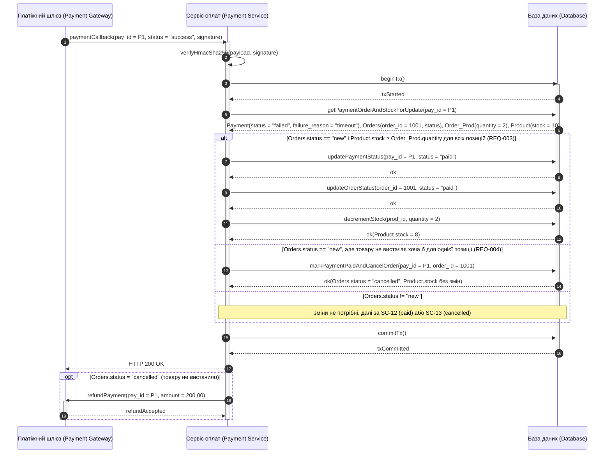

## SC-10: Повідомлення з недійсним підписом (`UC-15`, `REQ-013`)

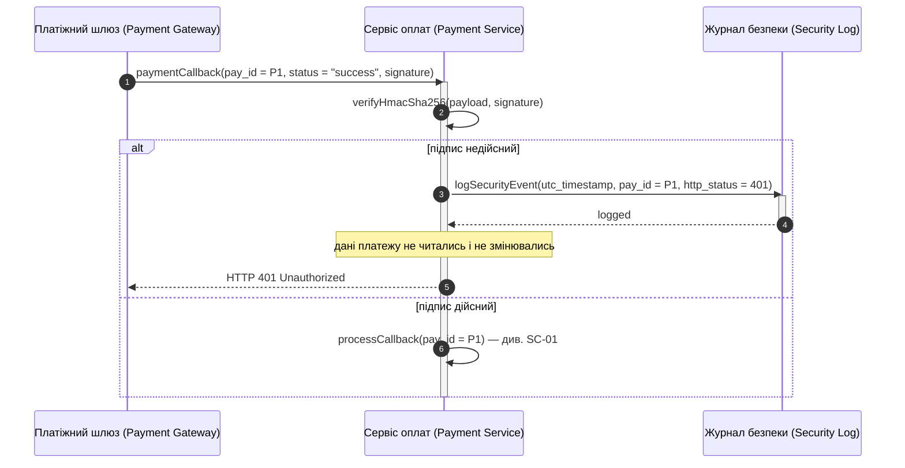

## SC-11: Повідомлення про невідомий платіж (`UC-15`, `REQ-014`)

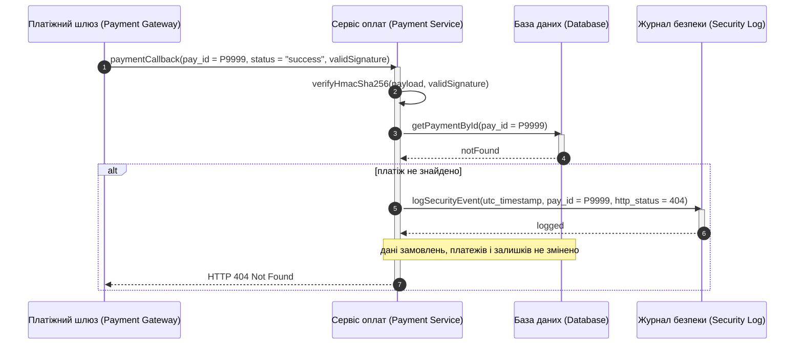

## SC-12: Запізніле success після таймауту, замовлення вже оплачене (`UC-14`, `UC-15`, `REQ-002`, `REQ-005`, `REQ-012`)

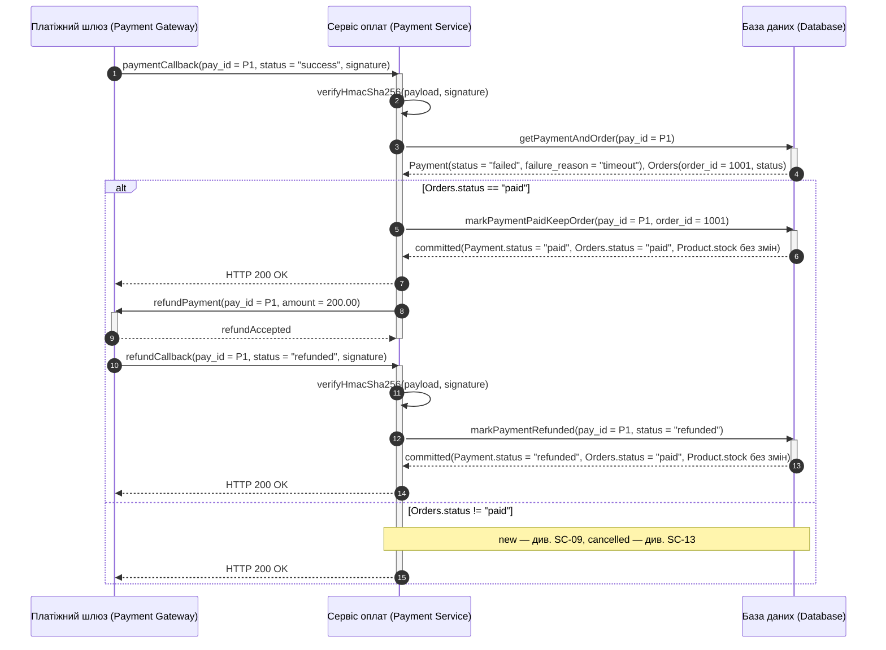

## SC-13: Запізніле success після таймауту, замовлення скасоване (`UC-14`, `UC-15`, `REQ-002`, `REQ-005`, `REQ-012`)

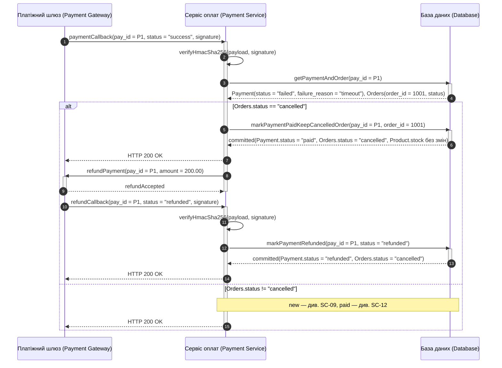

## SC-14: Другий платіж успішний, а замовлення вже оплачене (`UC-14`, `UC-15`, `REQ-002`, `REQ-005`)

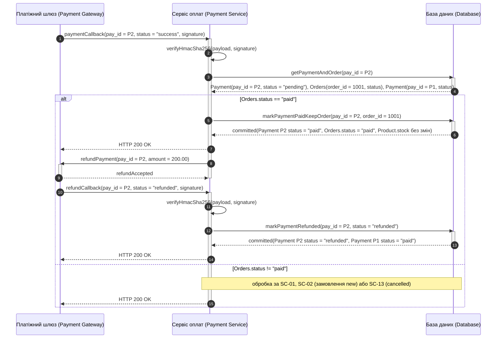

## SC-15: Гроші отримано, але товару вже немає (`UC-14`, `UC-15`, `REQ-004`, `REQ-005`)

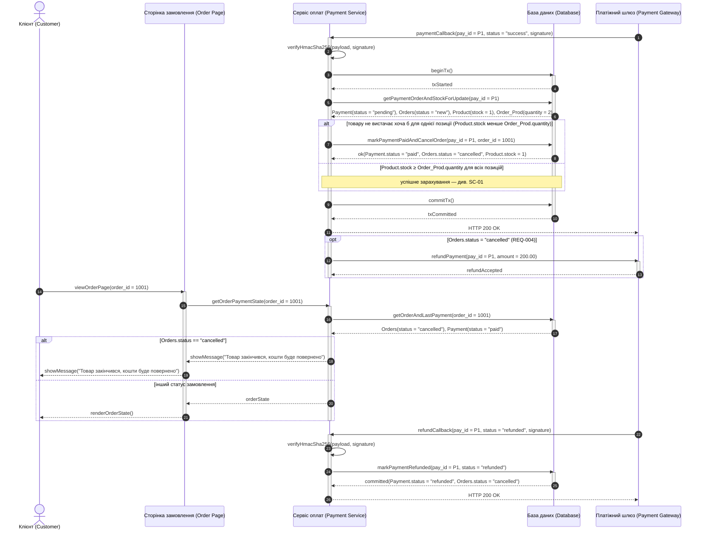