# Sequence-діаграми сценаріїв SC-01–SC-15

## SC-01: Успішна оплата (`UC-05`, `UC-15`, `REQ-001`, `REQ-003`)

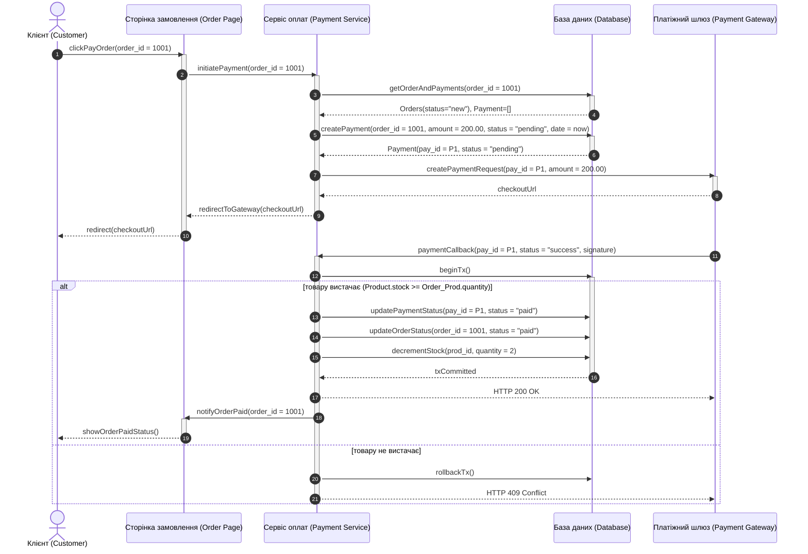

## SC-02: Повторна оплата після невдачі (`UC-05`, `UC-11`, `UC-15`, `REQ-003`, `REQ-008`)

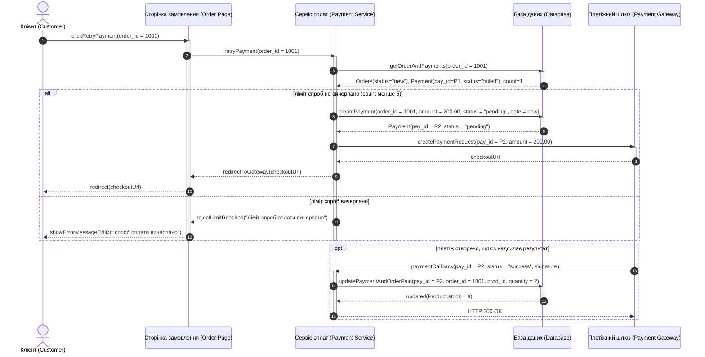

## SC-03: Оплату не можна розпочати (`UC-05`, `REQ-009`)

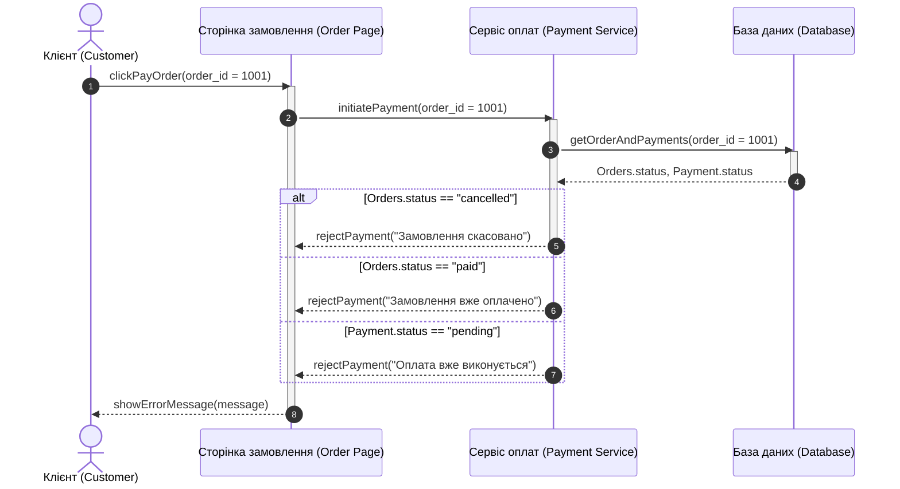

## SC-04: Ліміт спроб оплати вичерпано (`UC-05`, `UC-11`, `REQ-010`, `REQ-015`)

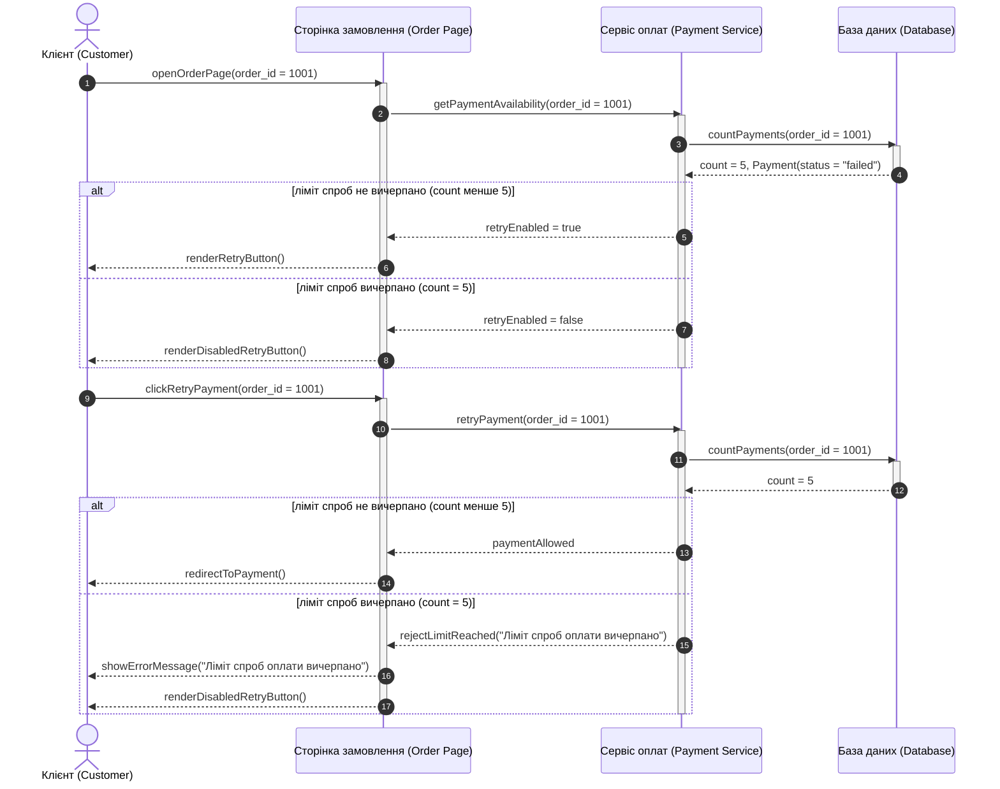

## SC-05: Шлюз відхилив платіж (`UC-15`, `REQ-006`, `REQ-015`)

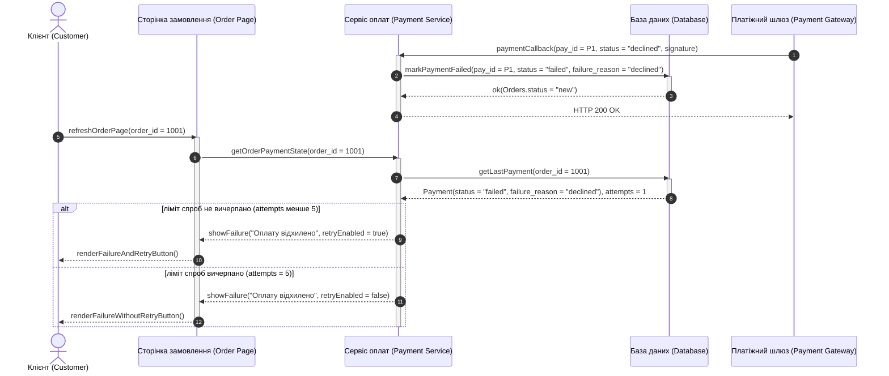

## SC-06: Шлюз не відповів за 15 хвилин (`UC-15`, `REQ-007`, `REQ-015`)

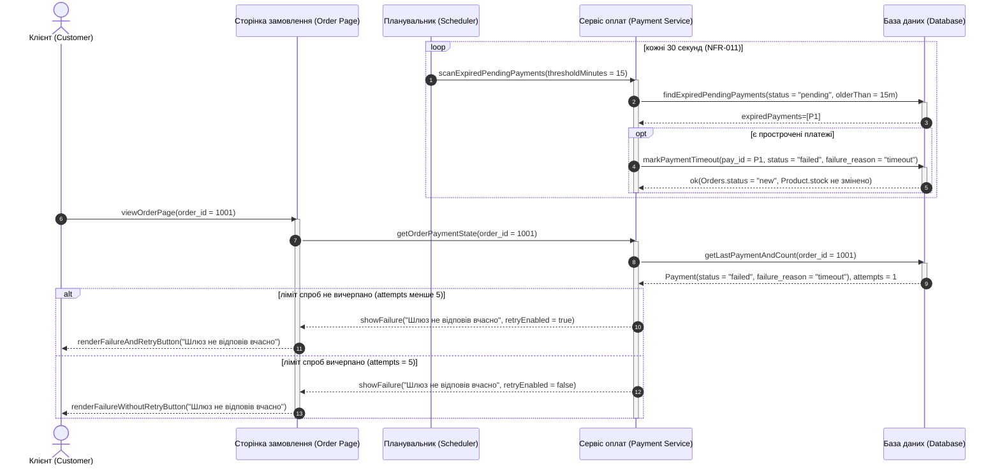

## SC-07: Дубльоване повідомлення шлюзу (`UC-15`, `REQ-011`)

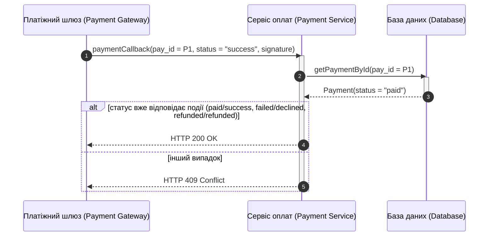

## SC-08: Суперечливе повідомлення шлюзу (`UC-15`, `REQ-016`)

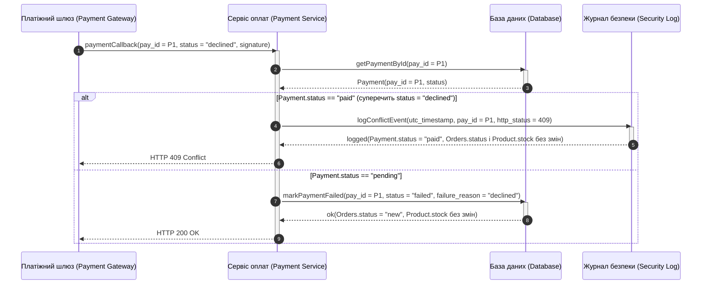

## SC-09: Запізніле success після таймауту, замовлення ще new (`UC-15`, `REQ-003`, `REQ-012`)

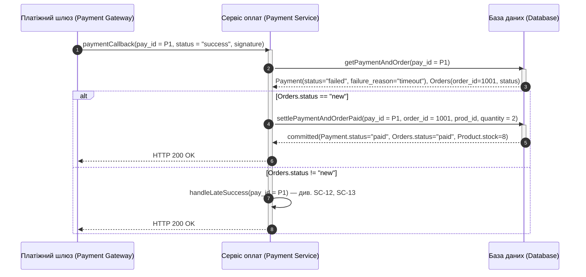

## SC-10: Повідомлення з недійсним підписом (`UC-15`, `REQ-013`)

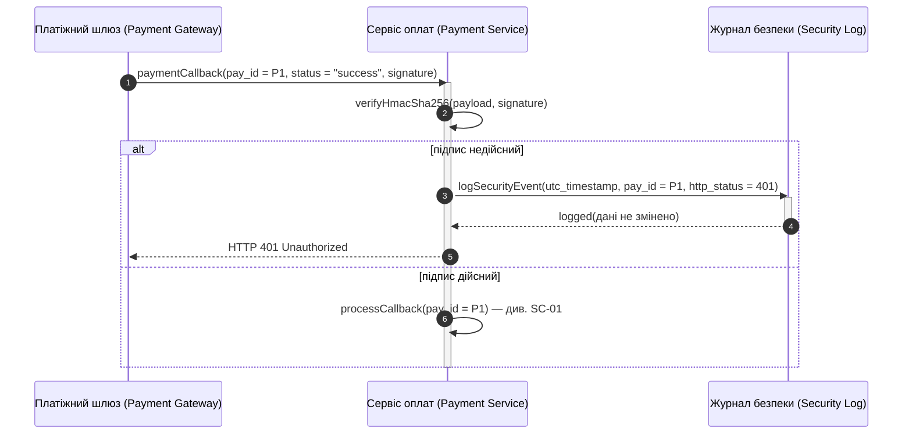

## SC-11: Повідомлення про невідомий платіж (`UC-15`, `REQ-014`)

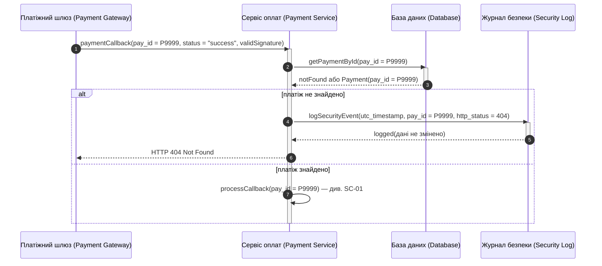

## SC-12: Запізніле success після таймауту, замовлення вже оплачене (`UC-14`, `UC-15`, `REQ-002`, `REQ-005`, `REQ-012`)

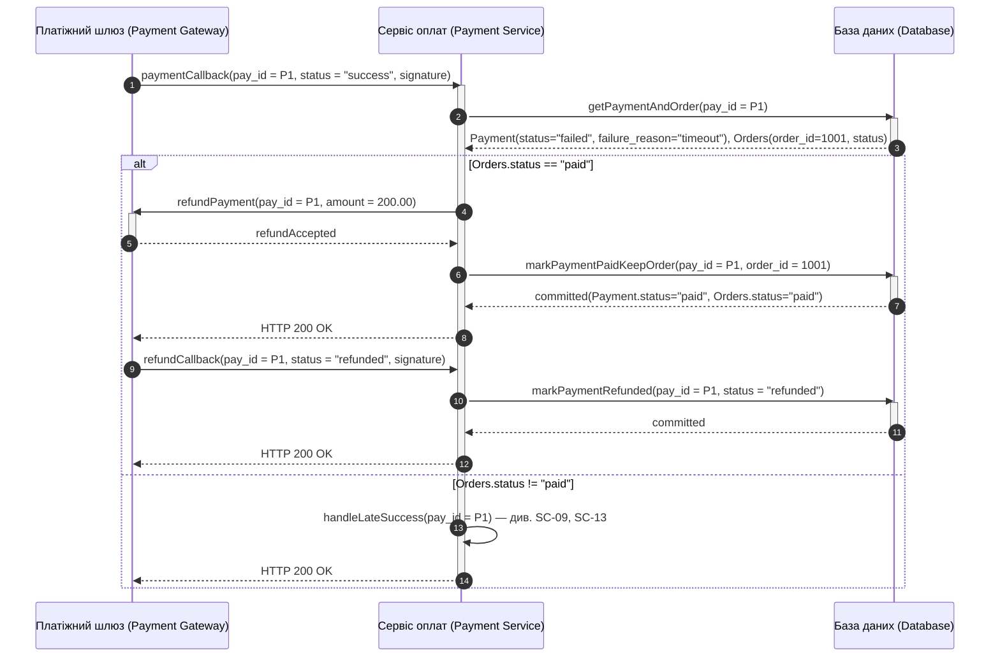

## SC-13: Запізніле success після таймауту, замовлення скасоване (`UC-14`, `UC-15`, `REQ-002`, `REQ-005`, `REQ-012`)

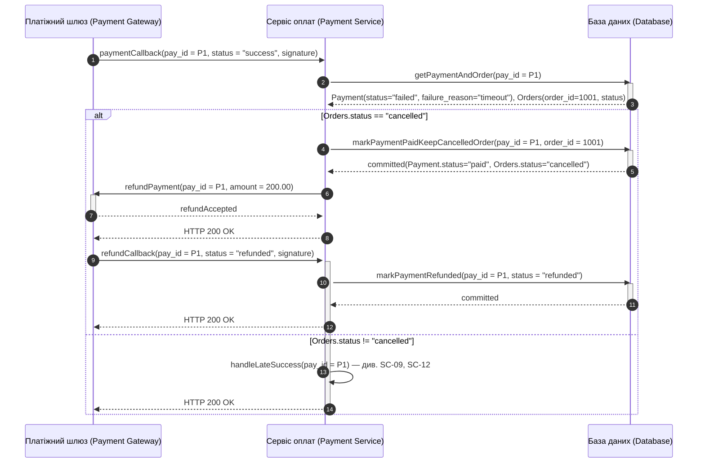

## SC-14: Другий платіж успішний, а замовлення вже оплачене (`UC-14`, `UC-15`, `REQ-002`, `REQ-005`)

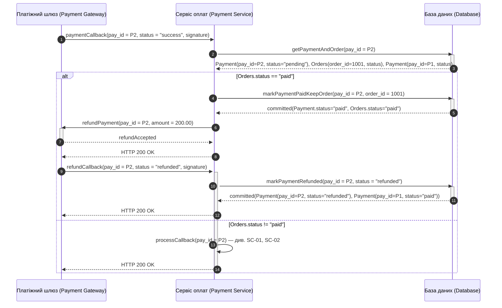

## SC-15: Гроші отримано, але товару вже немає (`UC-14`, `UC-15`, `REQ-004`, `REQ-005`)

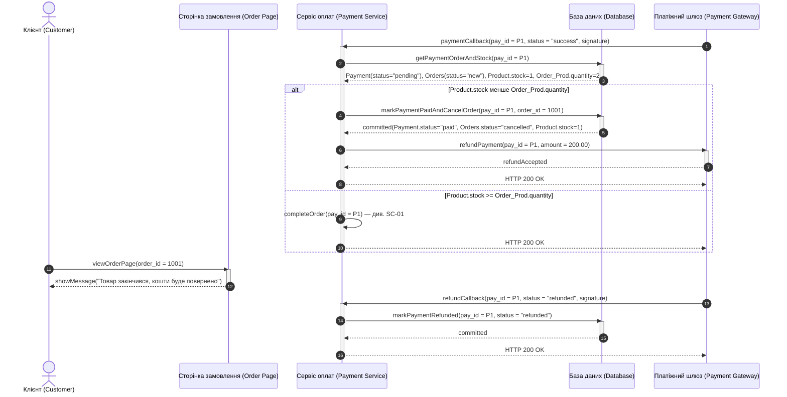